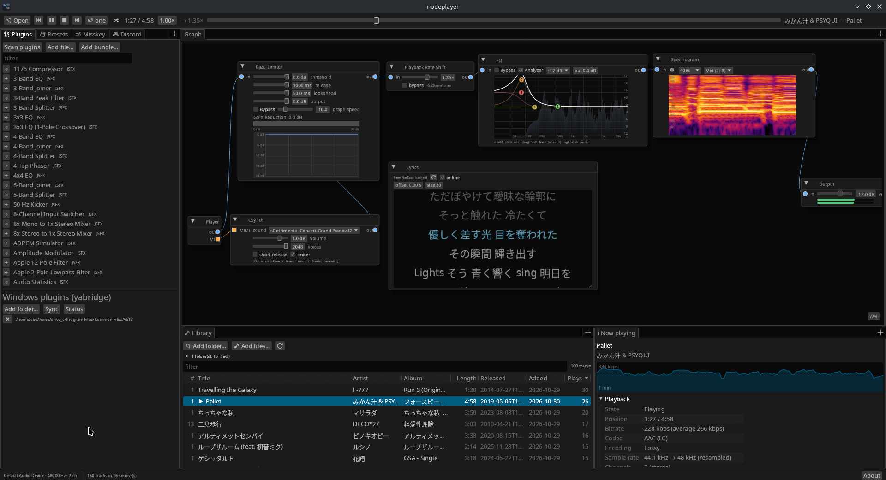

# nodeplayer guide

nodeplayer is a music player whose sound goes through a node graph you build yourself: a
Player node feeds effects, plugins and visualizers, and an Output node plays the result.

## Contents

1. [Getting started](getting-started.md): installing, the first start, the window, playing a song
2. [Library and playback](library-and-playback.md): the track list, the transport, looping a selection, the playback rate, Now playing, media keys
3. [The node graph](node-graph.md): adding and wiring nodes, the built-in nodes and visualizers, presets
4. [MIDI](midi.md): MIDI files as songs, CSynth, MIDI ports, the MIDI Monitor, Audio → MIDI
5. [Plugins](plugins.md): VST3, CLAP, JSFX and native plugins, plugin editors, Windows plugins through yabridge
6. [Lyrics and video](lyrics-and-video.md): the Lyrics and Video panels
7. [Sharing what's playing](sharing.md): Misskey NowPlaying, Discord Rich Presence, the system's media controls
8. [Files and troubleshooting](files-and-troubleshooting.md): where settings are kept, and fixes for common problems
9. [Development](development.md): building, the AppImage, debug commands, the source layout

## A first chain in two minutes

1. Start nodeplayer and drop a music folder onto the window. It appears in the Library.
2. Click a track. The default graph, Player → Output, plays it.
3. Right-click an empty spot in the graph and add **EQ**, then a **Visualizer → Spectrum**.
4. Drag from the Player's `out` pin to the EQ's `in`, from the EQ to the Spectrum, and from
   the Spectrum to the Output. Double-click in the EQ's graph to add a band and drag it.
5. Open 💾 Presets and save the graph under a name, to load it again later.
